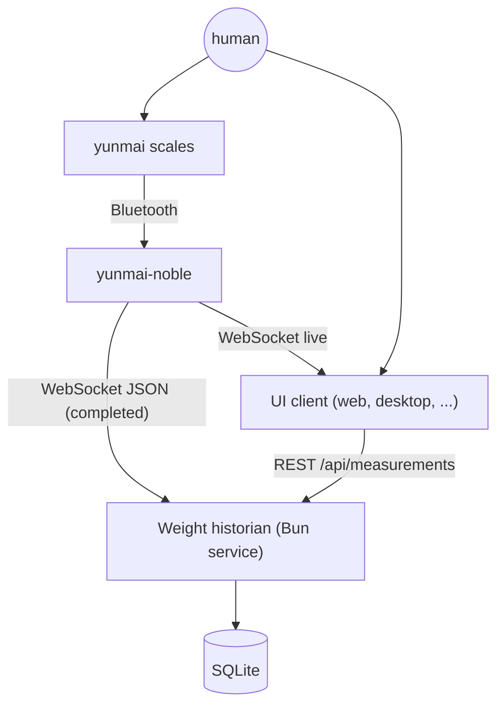

# yunmai-noble

Yunmai scales BLE node, simulator, and weight historian design.

## Idea



The UI client may be a web app, a desktop app (for example GPUI), or any other
consumer. The historian is a background Bun service that stores history and
serves the REST API.

## Repository layout

| Path | Purpose |
| --- | --- |
| `packages/node/` | BLE node, simulator, and node tests |
| `packages/contract/` | Shared WebSocket v1 zod schemas and types |
| `packages/historian/`, `packages/ui/` | Planned historian and UI clients |
| `project/` | Design and status documents |

## Install on Raspberry Pi

1. Install Docker
2. Run the installer; it builds the image from the current `Dockerfile` and
   starts the container:
```
$ curl -fsSL https://raw.githubusercontent.com/Vanuan/yunmai-noble/master/run.sh | sh
```

The deployment image uses Node 22 and npm so it builds on 32-bit and 64-bit
ARM. Bun is used for development and tests, but has no arm32 image.

## Development (on any laptop that supports BLE)

Requires Node 22 for the real BLE link (see `.nvmrc`) and Bun 1.3+ for package
management, tests, and TypeScript. Local development does not use Docker.

```
$ bun install
$ bun run start
Bluetooth poweredOn
Looking for peripheral...
Yunmai scales detected
Waiting for weighting...
[Sun Nov 01 2026 15:35:16 GMT+0200] 7.9 kg
[Sun Nov 01 2026 15:35:16 GMT+0200] 7.7 kg
[Sun Nov 01 2026 15:35:16 GMT+0200] 7.5 kg
```

## Simulator (no BLE hardware)

Set `BLE_DRIVER=simulator` to replace the Bluetooth link with a simulated
Yunmai scale:

```
$ bun install
$ BLE_DRIVER=simulator bun run dev
```

The simulator implements the same link API as `noble`, emits measuring and
measured packets, and responds to commands on characteristic `ffe4`. It is
configured with `SIMULATOR_*` variables such as `SIMULATOR_WEIGHT_KG`,
`SIMULATOR_STEPS`, and `SIMULATOR_INTERVAL_MS`.

Run it interactively with `bun run simulate`; run `bun test` and
`bun run typecheck`.

Bun runs the simulator and the test suite. The real BLE link still runs on Node
22 because `@abandonware/bluetooth-hci-socket` is a native addon built for
Node's ABI and cannot be loaded by Bun.

## WebSocket contract

The message format is specified in [`project/WEBSOCKET.md`](project/WEBSOCKET.md).
TypeScript types and zod schemas live in
`packages/contract/src/websocket.ts`.

## BLE transport

The current link uses `@abandonware/noble` on Node 22. The planned migration to
a pure-JS BlueZ D-Bus transport (Bun-compatible, no native addons) is
documented in
[`project/BLE-TRANSPORT-MIGRATION.md`](project/BLE-TRANSPORT-MIGRATION.md).

