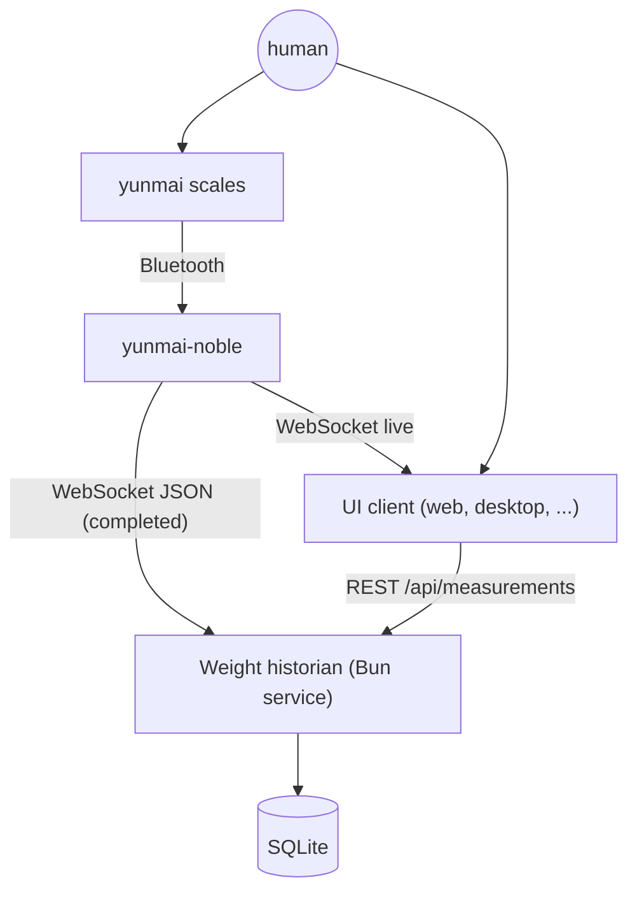

# yunmai-noble

Yunmai scales BLE node, simulator, weight historian, web dashboard, and a
single-executable suite that runs them together.

## Idea



The system has three external boundaries: BLE (D-Bus/HCI), persistence (file or
remote database), and HTTP/HTML/API. Only adapters touch OS, database, or HTTP
specifics. See [Architecture](project/ARCHITECTURE.md).

## Quick start

Requires Node 22 (`.nvmrc`) and Bun 1.3+.

```sh
bun install
bun test
bun run typecheck
```

## Run the whole suite

`bun run suite` is the single executable. It hosts the historian and web UI in
one Bun process, then starts one node child process per scale driver. Every
driver speaks the same v1 WebSocket contract, so the historian can follow any
combination of them at once.

```sh
bun run suite                              # dbus driver, UI at :3000
SUITE_SCALES=simulator bun run suite       # no hardware
SUITE_SCALES=dbus,simulator bun run suite  # real scale and simulation together
```

| Variable | Default | Meaning |
| --- | --- | --- |
| `SUITE_SCALES` | `dbus` | Initial drivers: `dbus`, `simulator`, `noble` |
| `SUITE_WS_PORT_BASE` | `8080` | Driver ports: dbus `base`, simulator `base+1`, noble `base+2` |
| `SUITE_NODE_ID_PREFIX` | `scale` | Device identity is `prefix-driver` |
| `SUITE_DRIVER_RESTART_MS` | `2000` | Restart delay after a driver exits; `0` disables |
| `HISTORIAN_PORT`, `HISTORIAN_HOST` | `3000`, `0.0.0.0` | HTTP/UI bind address |
| `DATABASE_PATH` | `./data/historian.sqlite` | SQLite file |

### Runtime driver switching

Drivers can be started and stopped without restarting the suite, so the
simulator can feed the dashboard next to real hardware:

```sh
curl http://127.0.0.1:3000/api/suite
curl -X POST http://127.0.0.1:3000/api/suite/drivers/simulator/start
curl -X POST http://127.0.0.1:3000/api/suite/drivers/dbus/stop
```

`GET /api/suite` returns each driver's state (`stopped`, `running`,
`restarting`, ...), pid, port, device id, restart count, and upstream status.
A crashed driver restarts after `SUITE_DRIVER_RESTART_MS` unless stopped.

Drivers are child processes so they stay isolated and can use different
runtimes: `dbus` and `simulator` run under Bun, `noble` under Node 22. The
historian and UI stay in the single Bun process. A desktop distribution can
embed the same supervisor, or ship the suite as its sidecar.

The components can still run individually while developing: `bun run dev`
(node only), `bun run historian`, `bun run ui`, and `bun run build:ui`. The
suite builds `packages/ui/dist` on first run; rebuild it with
`bun run build:ui` after UI changes.

## Simulator

`SUITE_SCALES=simulator` runs a scale below the GATT layer inside the node
child. It repeats a weighing every few seconds and accepts the same commands as
the hardware. Tune it with `SIMULATOR_WEIGHT_KG`, `SIMULATOR_STEPS`,
`SIMULATOR_INTERVAL_MS`, `SIMULATOR_CYCLE_DELAY_MS`, and `SIMULATOR_REPEAT`.

`bun run simulate` is a separate interactive REPL that speaks the scale side of
the protocol: `start`, `stop`, `history`, `unit kg|lb`, `user <id>`. It is for
inspecting packets and acks, not for feeding the node.

## Web UI

The dashboard is React + Vite + Tailwind in `packages/ui`. It reads history from
the HTTP API, follows live updates over SSE, and is served from
`packages/ui/dist` by the historian. See
[packages/ui/README.md](packages/ui/README.md) for GPUI portability notes.

## BLE drivers

- `dbus` (default): needs BlueZ and the system D-Bus socket. On NixOS, enable
  `hardware.bluetooth.enable` and `hardware.bluetooth.powerOnBoot`; set
  `DBUS_SYSTEM_BUS_ADDRESS=unix:path=/run/dbus/system_bus_socket` if
  `/var/run` is not available.
- `noble` (legacy): native HCI; Node 22 only, with adapter access.
- `simulator`: no hardware.

On hosts with AppArmor or SELinux confining Docker, allow the container to use
the system D-Bus socket, or use the legacy noble image.

## Raspberry Pi

```sh
./run.sh          # default D-Bus image
./run.sh noble    # legacy native HCI image
```

Or run the installer remotely:

```sh
curl -fsSL https://raw.githubusercontent.com/Vanuan/yunmai-noble/master/run.sh | sh
```

The D-Bus image mounts `/run/dbus/system_bus_socket` and does not need
privileged networking, though the host security policy must allow D-Bus
access. The legacy image uses `--privileged` and host networking. Both use
Node 22 and npm so they work on arm32; Bun has no arm32 image.

## Repository layout

```
packages/node       BLE node, simulator, and tests
packages/contract   WebSocket v1 schemas and types
packages/historian  SQLite, HTTP API, SSE, v0/v1 ingest
packages/suite      Single executable: historian + UI + driver supervisor
packages/ui         React/Vite/Tailwind dashboard
apps/desktop        planned Rust/GPUI desktop client
project/            design and status documents
```

## Documentation

- [Status](project/STATUS.md), [Roadmap](project/ROADMAP.md),
  [Architecture](project/ARCHITECTURE.md)
- [WebSocket contract](project/WEBSOCKET.md)
- [Historian design](project/HISTORIAN.md)
- [Deployment plan](project/DEPLOYMENT.md)
