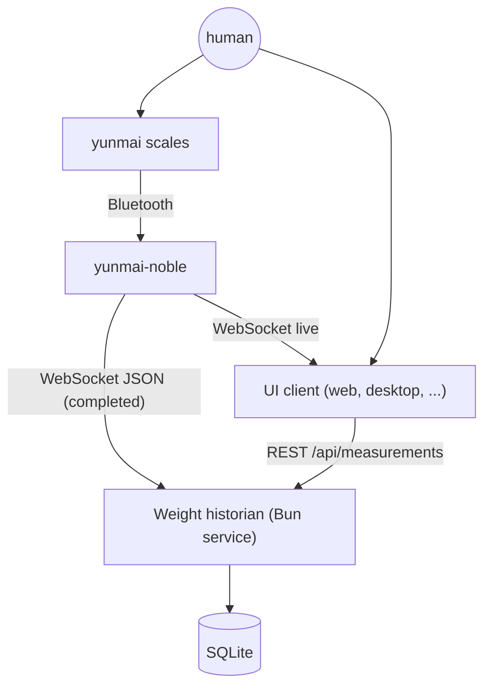

# yunmai-noble

Yunmai scales BLE node, simulator, weight historian, and web dashboard.

## Idea



The system has three external boundaries: BLE (D-Bus/HCI), persistence (file or
remote database), and HTTP/HTML/API. Only adapters touch OS, database, or HTTP
specifics. See [Architecture](project/ARCHITECTURE.md).

## Quick start

Requires Node 22 (`.nvmrc`) and Bun 1.3+.

```sh
bun install
bun test
bun run typecheck
```

## Run the whole suite

The suite is three processes that can share one host: the node (BLE link and
WebSocket source), the historian (SQLite, HTTP API, SSE), and the web app
(served by the historian, or by Vite in development). This is the topology a
desktop distribution will package as one unit.

| Process | Command | Endpoint |
| --- | --- | --- |
| Node + simulated scale | `BLE_DRIVER=simulator bun run dev` | `ws://127.0.0.1:8080` |
| Historian | `bun run historian` | `http://127.0.0.1:3000` |
| Web app (built) | `bun run build:ui` | `http://127.0.0.1:3000` |
| Web app (dev server) | `bun run ui` | `http://127.0.0.1:5173` |

Terminal 1, a simulated scale that emits a reading every few seconds:

```sh
BLE_DRIVER=simulator bun run dev
```

Terminal 2, the historian subscribed to the node:

```sh
DATABASE_PATH=./data/historian.sqlite \
YUNMAI_WS_URL=ws://127.0.0.1:8080 \
bun run historian
```

Build the dashboard once and open `http://127.0.0.1:3000`:

```sh
bun run build:ui
```

For frontend work, run `bun run ui` instead; Vite proxies `/api` and `/health`
to the historian on port 3000.

Real hardware replaces the simulator without changing the rest of the suite:

```sh
BLE_DRIVER=dbus bun run start    # default BlueZ D-Bus driver
BLE_DRIVER=noble bun run start   # legacy native HCI, Node 22 only
```

The node publishes on `WS_PORT` (default `8080`) as device `NODE_ID` (default
`yunmai-noble`). The historian listens on `HISTORIAN_PORT=3000`; set
`DATABASE_PATH` to a writable file (the default `/data/historian.sqlite` is
meant for containers).

## Simulator

`BLE_DRIVER=simulator` runs a scale below the GATT layer inside the node. It
repeats a weighing every few seconds and accepts the same commands as the
hardware. Tune it with `SIMULATOR_WEIGHT_KG`, `SIMULATOR_STEPS`,
`SIMULATOR_INTERVAL_MS`, `SIMULATOR_CYCLE_DELAY_MS`, and `SIMULATOR_REPEAT`.

`bun run simulate` is a separate interactive REPL that speaks the scale side of
the protocol: `start`, `stop`, `history`, `unit kg|lb`, `user <id>`. It is for
inspecting packets and acks, not for feeding the node.

## Web UI

The dashboard is React + Vite + Tailwind in `packages/ui`. It reads history from
the HTTP API, follows live updates over SSE, and is served from
`packages/ui/dist` by the historian. See
[packages/ui/README.md](packages/ui/README.md) for GPUI portability notes.

## BLE drivers

- `dbus` (default): needs BlueZ and the system D-Bus socket. On NixOS, enable
  `hardware.bluetooth.enable` and `hardware.bluetooth.powerOnBoot`; set
  `DBUS_SYSTEM_BUS_ADDRESS=unix:path=/run/dbus/system_bus_socket` if
  `/var/run` is not available.
- `noble` (legacy): native HCI; Node 22 only, with adapter access.
- `simulator`: no hardware.

On hosts with AppArmor or SELinux confining Docker, allow the container to use
the system D-Bus socket, or use the legacy noble image.

## Raspberry Pi

```sh
./run.sh          # default D-Bus image
./run.sh noble    # legacy native HCI image
```

Or run the installer remotely:

```sh
curl -fsSL https://raw.githubusercontent.com/Vanuan/yunmai-noble/master/run.sh | sh
```

The D-Bus image mounts `/run/dbus/system_bus_socket` and does not need
privileged networking, though the host security policy must allow D-Bus
access. The legacy image uses `--privileged` and host networking. Both use
Node 22 and npm so they work on arm32; Bun has no arm32 image.

## Repository layout

```
packages/node       BLE node, simulator, and tests
packages/contract   WebSocket v1 schemas and types
packages/historian  SQLite, HTTP API, SSE, v0/v1 ingest
packages/ui         React/Vite/Tailwind dashboard
apps/desktop        planned Rust/GPUI desktop client
project/            design and status documents
```

## Documentation

- [Status](project/STATUS.md), [Roadmap](project/ROADMAP.md),
  [Architecture](project/ARCHITECTURE.md)
- [WebSocket contract](project/WEBSOCKET.md)
- [Historian design](project/HISTORIAN.md)
- [Deployment plan](project/DEPLOYMENT.md)
