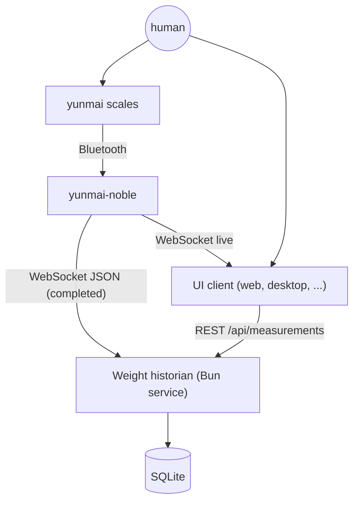

# yunmai-noble

Yunmai scales BLE node, simulator, and weight historian.

## Idea



The system has three external boundaries: BLE (D-Bus/HCI), persistence (file or
remote database), and HTTP/HTML/API. Only adapters touch OS, database, or HTTP
specifics. See [Architecture](project/ARCHITECTURE.md).

## Quick start

Requires Node 22 (`.nvmrc`) and Bun 1.3+.

```sh
bun install
bun test
bun run typecheck
```

Real scale, default BlueZ D-Bus driver:

```sh
bun run start
```

Legacy native `noble` driver on Node 22:

```sh
BLE_DRIVER=noble bun run start
```

Simulator, no hardware:

```sh
BLE_DRIVER=simulator bun run dev
bun run simulate
```

Historian, in a second terminal (accepts v1 and legacy v0 frames):

```sh
DATABASE_PATH=./data/historian.sqlite \
YUNMAI_WS_URL=ws://127.0.0.1:8080 \
bun run historian
```

Open `http://127.0.0.1:3000` for the dashboard.

## Web UI

The dashboard is React + Vite + Tailwind in `packages/ui`. Build it for the
historian, or run the dev server with API proxying:

```sh
bun run build:ui
bun run ui          # http://127.0.0.1:5173
```

## BLE drivers

- `dbus` (default): needs BlueZ and the system D-Bus socket. On NixOS, enable
  `hardware.bluetooth.enable` and `hardware.bluetooth.powerOnBoot`; set
  `DBUS_SYSTEM_BUS_ADDRESS=unix:path=/run/dbus/system_bus_socket` if
  `/var/run` is not available.
- `noble` (legacy): native HCI; Node 22 only, with adapter access.
- `simulator`: no hardware.

On hosts with AppArmor or SELinux confining Docker, allow the container to use
the system D-Bus socket, or use the legacy noble image.

## Raspberry Pi

```sh
./run.sh          # default D-Bus image
./run.sh noble    # legacy native HCI image
```

Or run the installer remotely:

```sh
curl -fsSL https://raw.githubusercontent.com/Vanuan/yunmai-noble/master/run.sh | sh
```

The D-Bus image mounts `/run/dbus/system_bus_socket` and does not need
privileged networking, though the host security policy must allow D-Bus
access. The legacy image uses `--privileged` and host networking. Both use
Node 22 and npm so they work on arm32; Bun has no arm32 image.

## Repository layout

```
packages/node       BLE node, simulator, and tests
packages/contract   WebSocket v1 schemas and types
packages/historian  SQLite, HTTP API, SSE, v0/v1 ingest
packages/ui         React/Vite/Tailwind dashboard
apps/desktop        planned Rust/GPUI desktop client
project/            design and status documents
```

## Documentation

- [Status](project/STATUS.md), [Roadmap](project/ROADMAP.md),
  [Architecture](project/ARCHITECTURE.md)
- [WebSocket contract](project/WEBSOCKET.md)
- [Historian design](project/HISTORIAN.md)
- [Deployment plan](project/DEPLOYMENT.md)
