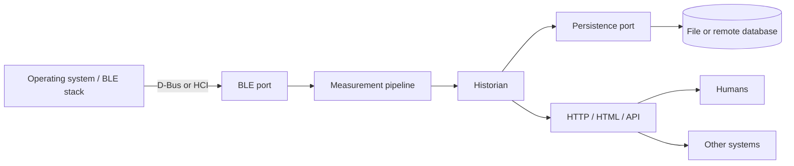

# System architecture

## Black-box view

The system has three boundaries with the outside world:

Everything else is internal: the node-to-historian WebSocket contract, packet
parsing, deduplication, and storage queries.

## The three boundaries

| Boundary | Direction | Adapters | Default | Failure behavior |
| --- | --- | --- | --- | --- |
| BLE | OS → system | `dbus` (BlueZ D-Bus), `noble` (raw HCI), `simulator` | `noble` today; `dbus` target | Wait for adapter/device; expose state; never import OS-specific code elsewhere |
| Persistence | System → storage | `bun:sqlite` file, in-memory test store, remote DB later | SQLite file | Surface storage failures; do not lose the transport |
| HTTP/HTML/API | System → humans and other systems | JSON REST, static HTML, optional SSE/WebSocket live relay | Historian server | Independent of BLE and storage implementations |

Only the adapters may depend on OS, database, or HTTP specifics. The domain
(packet parsing, measurement validation, deduplication) uses the shared
contract and stays portable.

## Package responsibilities

| Package | Owns | Must not contain |
| --- | --- | --- |
| `packages/contract` | v1 WebSocket messages and shared schemas/types | BLE, database, or HTTP code |
| `packages/node` | BLE port, packet normalization, v1 publishing | Persistence or UI code |
| `packages/historian` | Ingest, persistence port, HTTP API, serving the UI | BLE/HCI code |
| `packages/ui` | HTML/CSS/JS client assets | Direct BLE or database access |

The WebSocket link between node and historian is an internal interface, not one
of the three external boundaries. It can later be replaced by IPC if both run
on the same host, without changing the BLE, persistence, or HTTP surfaces.

## Data flow

1. The BLE adapter receives notifications and converts them into the v1
   measurement messages defined in [WEBSOCKET.md](WEBSOCKET.md).
2. The node publishes those messages over WebSocket.
3. The historian validates them with `@yunmai-noble/contract`, deduplicates
   completed measurements, and writes through the persistence port.
4. The HTTP surface serves JSON queries and the HTML UI. Live data may come
   from the node's WebSocket directly or be relayed by the historian; that
   decision is still open.

## Ports

### BLE port

Selected with `BLE_DRIVER` (`noble`, `dbus`, `simulator`). The port exposes
adapter state, discovery, connect/disconnect, GATT service and characteristic
access, notifications, and writes. See
[BLE-TRANSPORT-MIGRATION.md](BLE-TRANSPORT-MIGRATION.md).

### Persistence port

A `MeasurementStore` interface with:

- idempotent `insert(measurement)`
- `list({ from, to, userId, limit, before })`
- `latest({ userId })`
- `devices()`

SQLite via `bun:sqlite` is the first adapter. A remote database adapter can be
added without touching ingestion or HTTP code. See
[HISTORIAN.md](HISTORIAN.md).

### HTTP/HTML/API port

One HTTP server owns:

- `GET /api/...` JSON endpoints for other systems
- `GET /` static HTML/CSS/JS for humans
- optional live relay over SSE or WebSocket
- health and CORS behavior

UI clients are not required to be web apps; any client can consume the JSON
API. The default deployment serves the bundled UI from the historian, but the
same assets can be hosted separately.

## Configuration boundaries

| Variable | Boundary | Purpose |
| --- | --- | --- |
| `BLE_DRIVER` | BLE | `noble`, `dbus`, or `simulator` |
| `DBUS_SYSTEM_BUS_ADDRESS` | BLE | System D-Bus socket for the `dbus` driver |
| `SIMULATOR_*` | BLE | Simulated scale behavior |
| `DATABASE_PATH` / `DATABASE_URL` | Persistence | Storage location |
| `HISTORIAN_PORT` / `HISTORIAN_HOST` | HTTP | API and UI bind address |
| `CORS_ORIGIN` | HTTP | Allowed UI/API client origins |
| `YUNMAI_WS_URL` | Internal | Node stream consumed by the historian |
| `NODE_ID` | Contract | Device identity in v1 messages |

## Testing seams

- **BLE:** simulator for end-to-end runs, injected fake `node-ble` client for
  driver tests, real hardware only for validation.
- **Persistence:** in-memory store for historian tests, temporary SQLite file
  for query tests.
- **HTTP:** start the server on an ephemeral port and call it with `fetch`.
- **Contract:** zod schema tests.
- **System:** node simulator + historian + a fake UI client.

No test should require a Bluetooth adapter or an external database.

## Deployment topologies

- **Single host / Pi:** node and historian together; SQLite file; D-Bus or HCI
  BLE; one HTTP port.
- **Split:** node at the edge publishes the v1 stream; historian and database
  run remotely; the historian serves the API and UI.
- **UI elsewhere:** the historian exposes JSON only and a web or desktop client
  is deployed independently.

## Current state

- BLE port: `noble` implemented; `dbus` scaffold implemented; `simulator`
  implemented.
- Persistence: designed, not implemented.
- HTTP/HTML/API: designed, not implemented.
- v1 contract: defined; the node still emits v0.
