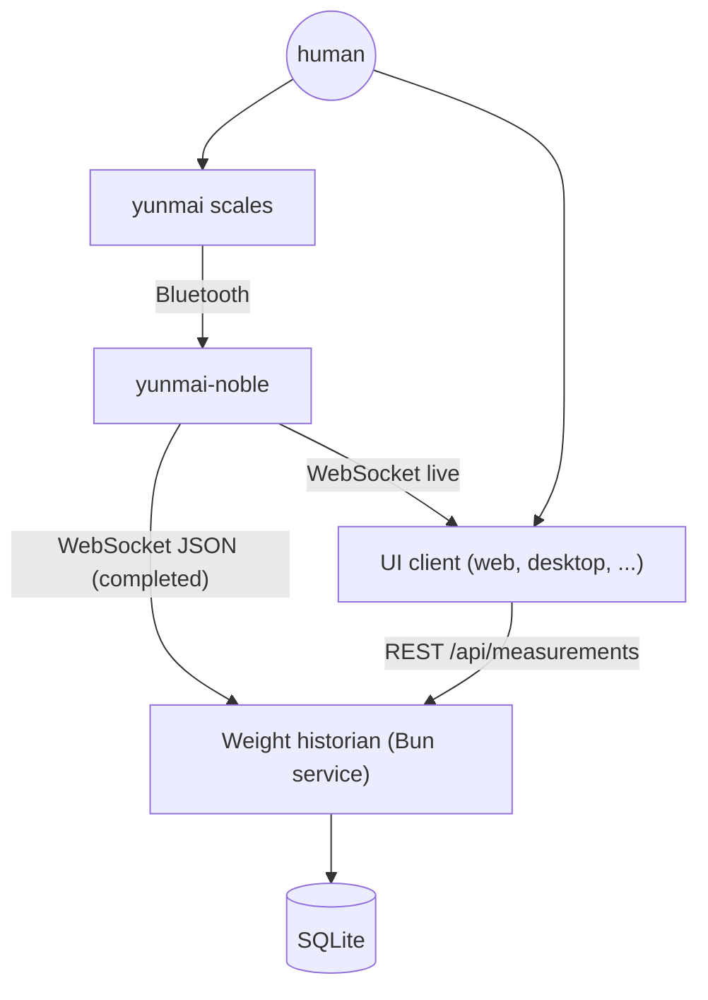
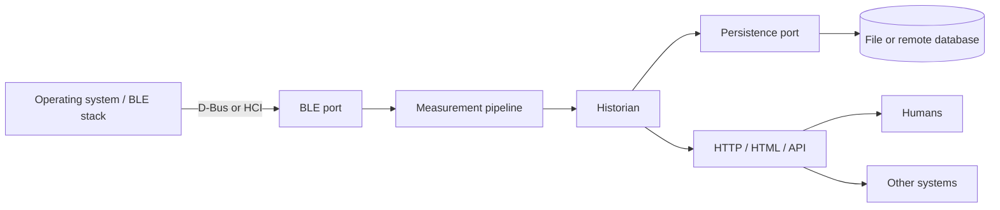

# System architecture

## Idea

Humans produce measurements on scales; the node normalizes them; clients read
history from the historian and live messages from the node.

## Black-box view

The three external boundaries are BLE, persistence, and HTTP/HTML/API. The
node-to-historian WebSocket contract, packet parsing, deduplication, and
storage queries are internal.

## Boundaries

| Boundary | Adapters | Default | Rule |
| --- | --- | --- | --- |
| BLE | `dbus` (BlueZ), `noble` (legacy HCI), `simulator` | `dbus` | Only BLE adapters touch the OS stack |
| Persistence | `bun:sqlite` file, in-memory tests, remote DB later | SQLite | Only the store adapter touches the database |
| HTTP/HTML/API | JSON REST, static HTML, optional SSE/WebSocket relay | Historian server | Only the HTTP layer touches clients |

## Packages

| Package | Owns | Must not contain |
| --- | --- | --- |
| `packages/contract` | v1 WebSocket schemas and types | BLE, DB, or HTTP code |
| `packages/node` | BLE port, packet normalization, v1 publishing | Persistence or UI |
| `packages/historian` | Ingest, store port, HTTP API, served UI assets | BLE/HCI code |
| `packages/suite` | One executable: historian, UI, driver supervision, control API | BLE packet parsing or storage |
| `packages/ui` | HTML/CSS/JS assets for the browser UI | Direct BLE or DB access |
| `apps/desktop` | Rust/GPUI desktop client using the HTTP API | Direct BLE, DB, or systemd access |

## Single executable

`packages/suite` hosts the historian and serves the built UI in one Bun process.
Each scale driver is a child node process with a stable device id and
OS-assigned loopback ports, communicating over the v1 WebSocket contract. This
keeps drivers isolated and lets `noble` use Node 22 while everything else runs
on Bun. Children watch stdin and exit if the suite disappears.

The control surface at `/api/suite` starts and stops drivers at runtime, so
simulated and real scales can feed the same historian concurrently. Simulator
routes are proxied to a loopback control server in the simulator node; the
virtual scale app at `/simulator/` uses them for a power switch, weight, user,
step-on, and history replay. A desktop distribution can embed this supervisor
or ship it as a sidecar.

## Desktop client

`apps/desktop` is a Rust/GPUI client built on `gpui-unofficial`. It reads the
historian's HTTP API (`/health`, `/api/measurements/latest`,
`/api/measurements`) and never touches BLE, SQLite, or the node WebSocket. The
first scaffold polls every two seconds; SSE live readings, a trend chart, and
simulator controls come next. Packaging pairs it with the suite in the Ubuntu
`.deb`.

## Ports

- **BLE:** selected with `BLE_DRIVER` (`dbus` default, `noble` legacy,
  `simulator`). Exposes state, discovery, connect/disconnect, GATT access,
  notifications, and writes. `dbus` uses BlueZ over the system D-Bus socket
  (host security policy must allow access); `noble` needs Node 22 and HCI
  adapter access.
- **Persistence:** `MeasurementStore` with idempotent `insert`, `list`,
  `latest`, and `devices`. See [HISTORIAN.md](HISTORIAN.md).
- **HTTP/HTML/API:** one server for JSON endpoints, static UI, health, CORS,
  and a live SSE/WebSocket relay. Browser and GPUI desktop clients use the same
  API; the desktop app never talks to the node or database directly.

## Data flow

1. The BLE adapter turns notifications into v1 measurement messages.
2. The node publishes them over WebSocket.
3. The historian validates with `@yunmai-noble/contract`, deduplicates, and
   stores them.
4. The HTTP surface serves history and the UI; the historian relays live v1
   messages over SSE for browser and desktop clients.

## Configuration

`packages/suite` reads `yunmai-noble.toml` from the working directory, then
`$XDG_CONFIG_HOME/yunmai-noble/config.toml`. `--config` or `YUNMAI_CONFIG`
selects another file; environment variables override file values.

| Variable | Boundary | Purpose |
| --- | --- | --- |
| `YUNMAI_CONFIG` | Internal | Config file path |
| `BLE_DRIVER` | BLE | `noble`, `dbus`, or `simulator` |
| `DBUS_SYSTEM_BUS_ADDRESS` | BLE | D-Bus socket for `dbus` |
| `SIMULATOR_*` | BLE | Simulated scale behavior |
| `DATABASE_PATH` / `DATABASE_URL` | Persistence | Storage location |
| `HISTORIAN_PORT`, `HISTORIAN_HOST` | HTTP | Bind address |
| `CORS_ORIGIN` | HTTP | Allowed client origins |
| `YUNMAI_WS_URL` / `YUNMAI_WS_URLS` | Internal | Node streams consumed by the historian |
| `NODE_ID` | Contract | Device identity in v1 |
| `SUITE_SCALES` | Internal | Drivers started by the suite |
| `SUITE_DRIVER_RESTART_MS` | Internal | Driver restart delay |

## Testing

- BLE: simulator for end-to-end runs, fake `node-ble` client for driver tests.
- Persistence: in-memory store and temporary SQLite files.
- HTTP: ephemeral server plus `fetch`.
- Contract: zod schema tests.
- Desktop: Rust unit tests for DTO parsing and formatting.

No test should require a Bluetooth adapter or an external database.

## Deployment

- **Single host / Pi:** node and historian together, SQLite file, one HTTP port.
- **Split:** node at the edge; historian and database remote.
- **Desktop:** Ubuntu `.deb` runs the service and a Rust/GPUI client that
  connects to loopback HTTP.
