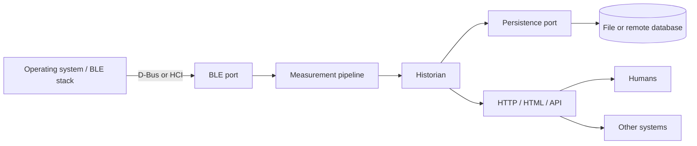

# System architecture

## Black-box view

The three external boundaries are BLE, persistence, and HTTP/HTML/API. The
node-to-historian WebSocket contract, packet parsing, deduplication, and
storage queries are internal.

## Boundaries

| Boundary | Adapters | Default | Rule |
| --- | --- | --- | --- |
| BLE | `dbus` (BlueZ), `noble` (legacy HCI), `simulator` | `dbus` | Only BLE adapters touch the OS stack |
| Persistence | `bun:sqlite` file, in-memory tests, remote DB later | SQLite | Only the store adapter touches the database |
| HTTP/HTML/API | JSON REST, static HTML, optional SSE/WebSocket relay | Historian server | Only the HTTP layer touches clients |

## Packages

| Package | Owns | Must not contain |
| --- | --- | --- |
| `packages/contract` | v1 WebSocket schemas and types | BLE, DB, or HTTP code |
| `packages/node` | BLE port, packet normalization, v1 publishing | Persistence or UI |
| `packages/historian` | Ingest, store port, HTTP API, served UI assets | BLE/HCI code |
| `packages/ui` | HTML/CSS/JS assets | Direct BLE or DB access |

## Ports

- **BLE:** selected with `BLE_DRIVER` (`dbus` default, `noble` legacy,
  `simulator`). Exposes state, discovery, connect/disconnect, GATT access,
  notifications, and writes. `dbus` uses BlueZ over the system D-Bus socket
  (host security policy must allow access); `noble` needs Node 22 and HCI
  adapter access.
- **Persistence:** `MeasurementStore` with idempotent `insert`, `list`,
  `latest`, and `devices`. See [HISTORIAN.md](HISTORIAN.md).
- **HTTP/HTML/API:** one server for JSON endpoints, static UI, health, CORS,
  and an optional live relay. Any client can use the JSON API.

## Data flow

1. The BLE adapter turns notifications into v1 measurement messages.
2. The node publishes them over WebSocket.
3. The historian validates with `@yunmai-noble/contract`, deduplicates, and
   stores them.
4. The HTTP surface serves history and the UI; live data comes from the node
   or an optional historian relay.

## Configuration

| Variable | Boundary | Purpose |
| --- | --- | --- |
| `BLE_DRIVER` | BLE | `noble`, `dbus`, or `simulator` |
| `DBUS_SYSTEM_BUS_ADDRESS` | BLE | D-Bus socket for `dbus` |
| `SIMULATOR_*` | BLE | Simulated scale behavior |
| `DATABASE_PATH` / `DATABASE_URL` | Persistence | Storage location |
| `HISTORIAN_PORT`, `HISTORIAN_HOST` | HTTP | Bind address |
| `CORS_ORIGIN` | HTTP | Allowed client origins |
| `YUNMAI_WS_URL` | Internal | Node stream consumed by the historian |
| `NODE_ID` | Contract | Device identity in v1 |

## Testing

- BLE: simulator for end-to-end runs, fake `node-ble` client for driver tests.
- Persistence: in-memory store and temporary SQLite files.
- HTTP: ephemeral server plus `fetch`.
- Contract: zod schema tests.

No test should require a Bluetooth adapter or an external database.

## Deployment

- **Single host / Pi:** node and historian together, SQLite file, one HTTP port.
- **Split:** node at the edge; historian and database remote.
- **UI elsewhere:** historian exposes JSON; any web or desktop client is
  deployed independently.
