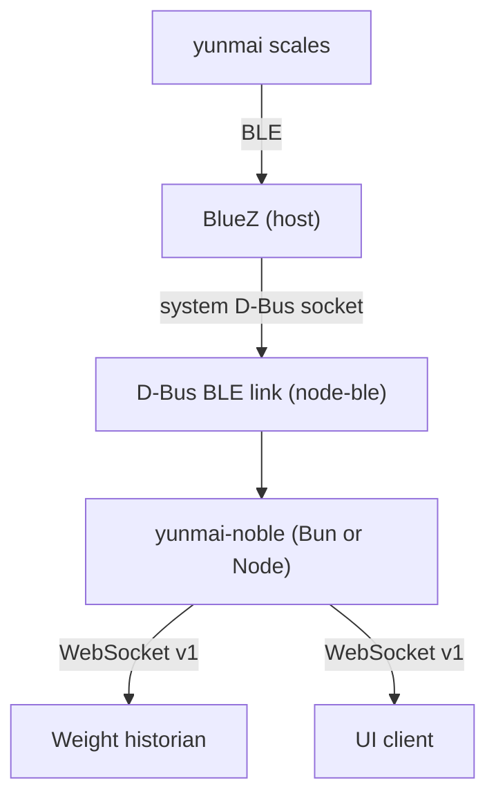

# BLE transport migration plan

Status: decided; `BLE_DRIVER=dbus` scaffold implemented and unit-tested;
real-scale validation pending.

## Decision

Migrate the BLE link from `@abandonware/noble` /
`@abandonware/bluetooth-hci-socket` to **`node-ble` over the BlueZ D-Bus API**
(Option 1), while keeping the native noble link as a **selectable legacy
driver**. Both drivers sit behind `BLE_DRIVER`, emit the same events, and can
coexist in the repository.

The target default is `dbus`. `noble` remains available for Node 22, arm32, and
hardware comparison; `simulator` remains available with no hardware. Do not
adopt the N-API `simpleble` route now; keep process separation (Option 3) as
the fallback if D-Bus cannot provide the required GATT behavior.

## Why

- The current HCI transport is a Nan/V8 addon. Bun uses JavaScriptCore, so it
  cannot load it without a rewrite to N-API.
- BlueZ exposes BLE through the system D-Bus. `node-ble` and `dbus-next` speak
  that protocol in JavaScript, so the link no longer needs a compiled addon.
- This also removes privileged networking and raw HCI access from the
  container: mount the D-Bus socket instead of using `--privileged` and
  `--network=host`.
- The same pure-JS driver runs under Node 22 on arm32 and under Bun on
  amd64/arm64, so native-module removal does not depend on Bun's architecture
  support.

## Verified findings

- `node-ble@1.13.0` depends on `dbus-next@0.10.2`.
- `dbus-next` declares the native `usocket` package as an optional dependency.
  It uses it for abstract Unix sockets and Unix-FD passing; for a path-based
  system bus it catches the missing module and falls back to
  `net.createConnection`.
- `node-ble` and `dbus-next` both load under Bun 1.3.13 with `usocket`'s
  install script blocked.
- Bun publishes `amd64` and `arm64` images only. A pure-Bun deployment
  therefore requires an arm64 host; arm32 keeps the Node image.
- Bun's recommended path to the system bus is a mounted Unix socket, not a
  network connection.
- `node-simpleble` is not an npm package. The published package is `simpleble`
  (`1.2.0`, `node-addon-api`, prebuilt via `prebuild-install`, last published
  2022). It is N-API based, but still a compiled binary; prebuilt-binary
  portability on NixOS is a risk.

## Options considered

| Option | Bun compatibility | NixOS / Pi | Effort | Verdict |
| --- | --- | --- | --- | --- |
| `node-ble` over BlueZ D-Bus | Yes; pure JS fallback | Good; socket mount, no native build | Medium: rewrite scan/GATT layer | **Selected** |
| `simpleble` (N-API) | Yes in principle | Native prebuilds; NixOS portability risk; older package | Medium | Deferred |
| Node BLE worker + IPC | Bun app, Node child | Keeps native + Node runtime | Low | Fallback during migration |

## Current implementation

- `packages/node/src/bluetooth/dbus/index.js` implements the noble-compatible
  link over `node-ble`: state events, discovery by name, UUID expansion,
  connect, GATT service/characteristic lookup, notifications, writes, and
  disconnect polling.
- `BLE_DRIVER=dbus` selects it; `noble` remains the default.
- `packages/node/test/dbus.test.js` tests the driver with an injected fake
  `node-ble` client (no D-Bus required).
- A smoke test against the host BlueZ bus reports `poweredOn`; a real scale has
  not been tested yet.

## Driver selection

`BLE_DRIVER` selects the transport at startup.

| Value | Runtime | Native addon | Host requirements | Purpose |
| --- | --- | --- | --- | --- |
| `noble` | Node 22 only | Yes (`bluetooth-hci-socket`) | Bluetooth adapter; privileged/HCI access | Legacy and hardware comparison |
| `dbus` | Node 22 or Bun | No | BlueZ + system D-Bus socket | Target default |
| `simulator` | Node 22 or Bun | No | None | Development and tests |

Rules:

- Selection is explicit. Do not silently fall back to another driver; a
  failure should exit with a clear message naming the selected driver and the
  missing dependency, daemon, socket, or permission.
- Both real drivers implement the same link contract and emit identical
  measurement events. `ble.js`, the WebSocket contract, and the historian do
  not know which driver is active.
- The default stays `noble` until `dbus` passes a real-scale validation, then
  flips to `dbus`. `noble` remains selectable afterwards.
- Driver-specific settings: `DBUS_SYSTEM_BUS_ADDRESS` for `dbus`, the
  simulator's `SIMULATOR_*` variables for `simulator`, and `NOBLE_*` settings
  for `noble` if needed.
- Log the selected driver and its runtime at startup for support.

### Packaging

- Move `@abandonware/noble` and the HCI socket to `optionalDependencies` in
  `packages/node`, so a D-Bus/Bun install can omit them with
  `--omit optional`.
- The D-Bus driver uses `node-ble` + `dbus-next`; keep the optional native
  `usocket` out of the install as well.
- Keep two deployment variants while the legacy driver is supported:
  - `Dockerfile` (default): D-Bus, Node or Bun, no build tools, no privileged
    networking.
  - `Dockerfile.noble` (legacy): Node 22, native build tools, privileged/HCI
    access.
- `run.sh` takes a driver/image choice or defaults to the D-Bus image; document
  the legacy command separately.

## Target architecture



## GATT mapping

The D-Bus API returns full 128-bit UUIDs. Expand the short UUIDs used today:

| Short | Full |
| --- | --- |
| `ffe0` | `0000ffe0-0000-1000-8000-00805f9b34fb` |
| `ffe4` | `0000ffe4-0000-1000-8000-00805f9b34fb` |

`node-ble` maps to the current flow as follows:

| Current noble call | D-Bus replacement |
| --- | --- |
| `noble.startScanning()` | `adapter.startDiscovery()` |
| `noble.on('discover')` | Poll `adapter.devices()`, then `getAlias()` / `getName()` / `getAdvertisingData()` for a `YUNMAI` match |
| `peripheral.connect()` | `adapter.waitDevice(address)` then `device.connect()` |
| `discoverServices(['ffe0'])` | `device.gatt()` then `getPrimaryService(FULL_FFE0)` |
| `discoverCharacteristics(['ffe4'])` | `service.getCharacteristic(FULL_FFE4)` |
| `characteristic.subscribe()` | `characteristic.startNotifications()` |
| `characteristic.on('data')` | `characteristic.on('valuechanged', buffer)` |
| `characteristic.write()` | `characteristic.writeValue(buffer)` |
| `peripheral.disconnect()` | `characteristic.stopNotifications()`, then `device.disconnect()`, then `destroy()` |

The D-Bus driver should keep the existing `BleLink` / peripheral-compatible
surface so `packages/node/ble.js` does not need to change. A later cleanup can
collapse it into a smaller `ScaleLink` interface.

## Migration phases

### 0. Freeze the boundary

- Keep `createLink({ driver })` in
  `packages/node/src/bluetooth/index.js` as the seam.
- Keep the simulator and protocol tests green.
- Finish the v1 WebSocket emitter independently of the BLE transport.

### 1. Add the D-Bus driver

Add `BLE_DRIVER=dbus` and a link implementation under
`packages/node/src/bluetooth/dbus/`:

- Create the bus with `createBluetooth()`.
- Use `bluetooth.defaultAdapter()` (or `activeAdapters()` later).
- Start discovery; poll `adapter.devices()` and match `YUNMAI` against the
  alias, name, or advertising data.
- Connect, fetch GATT service/characteristic with full UUIDs, subscribe to
  `valuechanged`, and forward buffers as `data` events with
  `isNotification = true`.
- Map write commands to `writeValue`.
- On disconnect or bus loss, stop discovery, clean up, and emit the same
  lifecycle events as noble.

### 2. Test without hardware

- Inject a fake `node-ble` client into the driver for unit tests: discovery,
  name matching, UUID expansion, connect, notification forwarding, write, and
  disconnect.
- Keep the existing end-to-end simulator test; it exercises the app without
  any BLE stack.
- Add a manual checklist for a real scale on Linux and NixOS.

### 3. Switch the default and keep both drivers

- Make `dbus` the default once a real scale is verified.
- Keep `BLE_DRIVER=noble` as a supported legacy driver, not only a rollback
  switch. Document the runtime and hardware requirements for each.
- Log the selected driver at startup and include it in health/diagnostics.

### 4. Demote native dependencies

- Move `@abandonware/noble` and `@abandonware/bluetooth-hci-socket` to
  `optionalDependencies` so D-Bus/Bun installs can omit them.
- Drop `alpine-sdk`, `python3`, `eudev-dev`, and `linux-headers` from the
  default image; the D-Bus client needs none of them.
- Install dependencies with optional packages omitted so `usocket` is not
  compiled: `bun install --omit optional` for Bun, or
  `npm ci --omit=dev --omit=optional` for the Node image.
- Keep the legacy noble image for as long as the driver is supported. Switch
  the default runtime image to Bun on amd64/arm64; keep a Node image for arm32
  or move arm32 to `dbus` under Node.

## NixOS

Enable BlueZ and D-Bus on the host:

```nix
{ pkgs, ... }: {
  hardware.bluetooth.enable = true;
  hardware.bluetooth.powerOnBoot = true;
  services.dbus.enable = true;
}
```

The system bus socket is `/run/dbus/system_bus_socket`; `/var/run` is a
symlink to `/run` on NixOS. `dbus-next` defaults to
`unix:path=/var/run/dbus/system_bus_socket`, so set the canonical path in the
container:

```
DBUS_SYSTEM_BUS_ADDRESS=unix:path=/run/dbus/system_bus_socket
```

BlueZ D-Bus access is controlled by the host bus policy. `node-ble` documents
a policy file for non-root users (`/etc/dbus-1/system.d/node-ble.conf`). On
NixOS, install the equivalent with `environment.etc` or a D-Bus package. The
container mounts the host socket, so the **host** policy applies, not one
inside the image.

Run the node without privileged networking:

```
docker run -d --name yunmai \
  -e DBUS_SYSTEM_BUS_ADDRESS=unix:path=/run/dbus/system_bus_socket \
  -v /run/dbus/system_bus_socket:/run/dbus/system_bus_socket \
  -p 8080:8080 \
  yunmai-noble
```

The container user must be allowed to talk to `org.bluez`. Running as root in
the container usually works; a non-root user needs the host policy entry.

## Acceptance criteria

- `BLE_DRIVER=dbus bun run dev` discovers a real Yunmai scale on Linux/NixOS,
  subscribes to `ffe4`, and emits the same measurements as the noble link.
- `BLE_DRIVER=noble` still works on Node 22 with the legacy image.
- The v1 WebSocket contract output is identical for both drivers.
- The full test suite passes under Bun with no native BLE addon installed.
- The default deployment image runs without `--privileged` or
  `--network=host`, with only the D-Bus socket mounted and port `8080`
  published.
- `bun.lock` / `package-lock.json` reference noble only through optional
  dependencies.

## Risks

- **BlueZ/D-Bus permissions:** host policy and container user/group setup can
  block access even when the socket is mounted.
- **Library age:** `node-ble` and especially `dbus-next@0.10.2` are older; pin
  versions and be prepared to vendor a fix. The npm audit currently reports
  transitive vulnerabilities through this chain.
- **GATT differences:** discovery by name requires polling addresses; UUID
  expansion and BlueZ GATT caching may differ from noble.
- **Notifications:** validate buffer boundaries and notification ordering with
  a real scale.
- **Bun runtime path:** loading works; the full D-Bus round-trip and GATT flow
  still need validation on NixOS.
- **Optional `usocket`:** ensure it stays uninstalled; otherwise the pure-JS
  benefit is lost.
- **arm32:** Bun has no arm32 build. The D-Bus driver is JS and works under
  Node 22, so arm32 can migrate off native modules without moving to Bun.

## Rollback

Keep `BLE_DRIVER=noble` and the legacy Node 22 image as a supported option.
Switching back requires no data migration because the WebSocket contract and
historian storage schema are unchanged.
