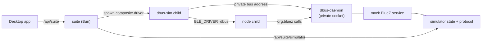

# D-Bus simulator driver (`dbus-sim`)

Status: design, not implemented.

## Goal

Add a fourth driver option that exercises the **real** `dbus` driver and
`node-ble` without a Bluetooth adapter. It runs a mock `org.bluez` service on a
private D-Bus and points the node child at that bus.

This is different from the existing `simulator` driver, which replaces the link
below GATT and never touches D-Bus.

| Driver id | UI label | Link | Requirements |
| --- | --- | --- | --- |
| `simulator` | Simulator | in-process fake link below GATT | none |
| `dbus-sim` | D-Bus (simulated) | real `dbus` driver → private mock BlueZ | `dbus-daemon` |
| `dbus` | D-Bus | real `dbus` driver → system BlueZ | BlueZ + adapter |
| `noble` | Node bindings | noble HCI | Node 22, `@abandonware/noble`, HCI capabilities |

`dbus-sim` is a test/demo mode. It does not touch the system bus or the real
Bluetooth adapter.

## Topology

The composite driver is one supervised child from the suite's point of view. It
owns the private bus, the mock service, and the node child.

## Process model

New tree under `packages/node/src/bluetooth/dbus-sim/`:

- `main.js` — starts the private bus, the mock service, the control server, and
  the node child with `BLE_DRIVER=dbus` and `DBUS_SYSTEM_BUS_ADDRESS`.
- `bus.js` — creates a temp directory and starts `dbus-daemon` with a private
  socket; waits for readiness; cleans up on exit.
- `bluez.js` — exports the mock `org.bluez` objects and signals.
- `control.js` — reuses the existing simulator control server and state.

The suite passes `WS_PORT`, `NODE_ID`, and `SIMULATOR_CONTROL_PORT` to the
composite driver. The composite driver:

1. Creates the private bus socket (mode 0700).
2. Starts the mock BlueZ service on that bus.
3. Starts the control server for power / weight / user / history.
4. Spawns `ble.js` with `BLE_DRIVER=dbus`,
   `DBUS_SYSTEM_BUS_ADDRESS=<private bus>`, and the assigned WS port.
5. Exits if stdin closes, and kills the bus and node child on SIGTERM/SIGINT.

If the node child exits, the composite driver exits; the suite restarts the
whole driver. The mock protocol and control server are reused from
`packages/node/src/bluetooth/simulator`.

## Mock BlueZ surface

Enough of the BlueZ object model for `node-ble`. The important detail is that
`node-ble` discovers children through **D-Bus introspection**
(`objectProxy.nodes`), not through `GetManagedObjects`. Each object therefore
needs valid `org.freedesktop.DBus.Introspectable` XML and
`org.freedesktop.DBus.Properties` Get/GetAll/Set.

- `/org/bluez` — introspection lists `hci0`; expose an empty
  `org.bluez.AgentManager1` because `Bluetooth` creates a `BusHelper` for it.
- `/org/bluez/hci0` — `org.bluez.Adapter1`; introspection lists the device
  path.
  - properties: `Address`, `Name`, `Powered`, `Discovering`, `UUIDs`
  - methods: `StartDiscovery`, `StopDiscovery`, `SetDiscoveryFilter`
- `/org/bluez/hci0/dev_AA_BB_CC_DD_EE_FF` — `org.bluez.Device1`
  - properties: `Address`, `Name` (`YUNMAI-SIM`), `Alias`, `Connected`,
    `ServicesResolved`, `RSSI`, `UUIDs`, `Adapter`
  - methods: `Connect`, `Disconnect`, `Pair` (no-op if needed)
- `/.../service0` — `org.bluez.GattService1` with the full UUID
  `0000ffe0-0000-1000-8000-00805f9b34fb`; properties `UUID`, `Primary`,
  `Characteristics`; introspection lists `char0`.
- `/.../char0` — `org.bluez.GattCharacteristic1` with the full UUID
  `0000ffe4-0000-1000-8000-00805f9b34fb`
  - properties: `UUID`, `Service`, `Flags` (`read`, `write`, `notify`),
    `Value`, `Notifying`
  - methods: `StartNotify`, `StopNotify`, `WriteValue`, `ReadValue`

Values in `Properties.Get`/`GetAll` and `PropertiesChanged` must be wrapped in
`Variant`; `node-ble` reads `changedProps.Value.value`.

Optional realism: emit
`org.freedesktop.DBus.ObjectManager.InterfacesAdded` when the device appears.
The driver polls `Adapter1` children instead, so this is not required for the
happy path.

Discovery flow:

1. `StartDiscovery` sets `Discovering=true` and starts reporting the device.
   The device object can exist from the start; polling `children()` is enough.
2. `Connect` sets `Connected=true` and `ServicesResolved=true` and emits
   `PropertiesChanged` for both.
3. `StartNotify` starts the measurement stream; `Notifying=true` and each
   packet is a `Value` change.
4. `WriteValue` parses command frames with the existing Yunmai protocol and
   replies through notifications.
5. `Disconnect` / `StopDiscovery` resets the stream.

The control server keeps the existing simulator API:
`power`, `start`, `stop`, `weight`, `user`, `unit`, `history`.

## Suite and API

- Add `dbus-sim` to `DRIVERS` and `isDriverName`.
- Node id: `<prefix>-dbus-sim`; the node still emits `BLE_DRIVER=dbus` in its
  environment.
- `availableDrivers()` advertises `dbus-sim` when `dbus-daemon` is present.
- `/api/suite/simulator` proxies to whichever simulated driver is active
  (`simulator` or `dbus-sim`), so the existing web page and the standalone GPUI
  simulator UI work unchanged.
- Config: `SUITE_SCALES=dbus-sim` or `[drivers] initial = ["dbus-sim"]`;
  `[simulator]` settings apply to the virtual scale.
- No new config key for the private bus; it uses a temporary path and cleans
  up.

## Desktop UI

The driver picker lives in a **Settings** dialog opened from the titlebar.
The dashboard itself stays free of settings. The dialog groups the sources and
lists each driver with a one-line description:

- Simulated
  - Simulator — “Built-in virtual scale below GATT”
  - D-Bus (simulated) — “Real D-Bus driver against a private mock BlueZ”
- Hardware
  - D-Bus — “System BlueZ. Needs an adapter.”
  - Node bindings — “Noble HCI. Needs Node 22 and the native addon.”

Interaction:

- Each row shows the driver label, description, and a state/requirement dot.
- Unavailable drivers are muted and non-selectable, with the reason visible.
- Selecting a row starts it and stops the other drivers; the dialog stays open
  so the state change is visible.
- Selecting the active row stops it and clears the saved choice.
- The active driver’s state and error stay below the list.
- The choice is persisted in `~/.config/yunmai-noble/desktop.json` and
  reapplied on launch.

A compact dropdown can replace the list if the dialog grows beyond these four
drivers.

## Packaging

- `dbus-daemon` is already part of the `dbus` package dependency.
- `dbus-next` becomes a direct dependency of `packages/node` (it is currently
  transitive through `node-ble`).
- The mock runs under Bun; no Node, native addon, or Bluetooth capabilities
  are needed.
- The deb includes the source; no extra unit or package.
- This mode works in containers and CI, unlike `dbus` or `noble`.

## Testing

- Integration test: start the suite with `dbus-sim`, wait for `/api/suite`,
  power and start the virtual scale through `/api/suite/simulator`, then assert
  a measurement appears in `/api/measurements`.
- Skip when `dbus-daemon` is unavailable.
- No adapter, BlueZ service, or polkit is required.
- Unit tests cover availability, control routing, and the new label/state map.

## Phases

1. Prototype the private bus + mock BlueZ and run `ble.js` against it manually.
2. Add the `dbus-sim` driver to the suite, availability, and control proxy.
3. Add the desktop dropdown option and persistence.
4. Add the CI integration test and docs.
5. Optional lab follow-up: register a real GATT peripheral with
   `GattManager1` + `LEAdvertisingManager1` for an on-air demo.

## Risks

- Mock BlueZ can drift from real BlueZ; derive the surface from `node-ble`’s
  calls and keep it minimal.
- Private bus lifecycle must be leak-free (socket, daemon, node child).
- `dbus-sim` tests the driver, not the kernel or radio. The real peripheral
  path remains a hardware lab exercise.
- A fourth option can confuse users; label it as a test/demo source and keep it
  grouped under “Simulated”.
