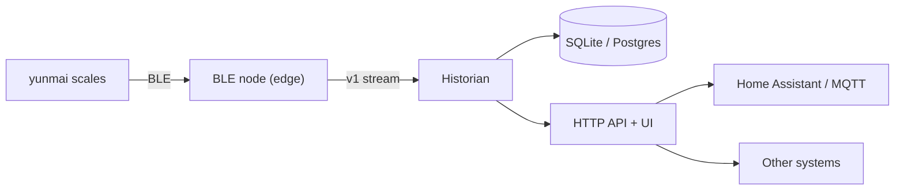

# Deployment plan

## Goal

Ship the same three-boundary system (BLE, persistence, HTTP/HTML/API) on four
targets with one contract and one data model. The BLE placement changes; the
historian and HTTP surface stay the same.

Node and historian may run on the same host or on different networks.

## Component placement

| Target | BLE node | Historian | Client | Storage | Integration |
| --- | --- | --- | --- | --- | --- |
| Raspberry Pi | Pi (D-Bus) | Pi | Browser UI | SQLite | Home Assistant via REST/MQTT |
| Docker cloud | Local agent (Pi / laptop) | Cloud container | Browser / API clients | Postgres or SQLite volume | Public API over TLS |
| NixOS edge | Edge device (D-Bus) | Edge device | LAN browser | SQLite | LAN UI/API |
| Ubuntu laptop | Laptop (D-Bus) | Same `.deb` service | Rust/GPUI app | SQLite | Desktop app, optional HA |

## Raspberry Pi (smart home / Home Assistant)

**Recommended shape:** one host running the node and historian, SQLite on disk,
HTTP on the LAN, Home Assistant as a consumer.

- BLE: `dbus` default against host BlueZ; `noble` legacy only if D-Bus is
  unavailable.
- Packaging options:
  - **Home Assistant OS add-on:** container with `host_dbus: true` and a
    persistent `/data` volume. Validate host D-Bus access on HAOS; fall back to
    `noble` with `NET_ADMIN`/`NET_RAW` if needed.
  - **Raspberry Pi OS:** systemd units or Docker Compose; `run.sh dbus` works
    for the container path.
- Home Assistant integration:
  - Phase 1: REST sensor polling `/api/measurements/latest` and
    `/api/measurements`.
  - Phase 2: historian MQTT publisher with HA discovery for event-driven
    measurements.
  - ESPHome Bluetooth Proxy cannot decode the Yunmai protocol without a custom
    component; do not rely on it.
- UI: served from the historian at `http://<pi>:3000`.

## Docker service (cloud) with a local agent

Run the historian and UI in the cloud; keep a small agent on the local network
for BLE. This avoids exposing the home network.

- **Preferred agent:** the existing node on a Pi, NUC, or old laptop. It
  connects **outbound** to the cloud and pushes v1 messages over WSS, so no
  inbound ports or VPN are required.
- **Cloud:** historian container behind a TLS reverse proxy; SQLite volume for
  one instance, Postgres for HA/multi-instance; API protected by a token.
- **Ingest:** add a historian-side WSS ingest endpoint with per-device tokens;
  the current historian design is a WebSocket client and must gain this mode.
- **Alternative:** a WireGuard/Tailscale link, with the historian connecting to
  the node's LAN WebSocket. Simpler security, more network setup.
- **ESP32 option:** feasible as a low-power BLE-to-Wi-Fi agent, but it is not a
  drop-in node. It needs a BLE-central implementation, Yunmai packet parsing,
  TLS/MQTT, provisioning, and OTA updates. Start with a Pi/laptop agent; treat
  ESP32 as a later prototype that publishes the same v1 MQTT payloads.
- HA integration remains via MQTT or the cloud API.

## NixOS edge device

Package the stack natively and expose it on the local network.

- Flake outputs: `packages.yunmai-node`, `packages.yunmai-historian`,
  `nixosModules.yunmai-noble`, `overlay.default`.
- Module options: `enable`, `driver` (`dbus`), `nodeId`, `dataDir`, `port`,
  `historian.enable`, `corsOrigin`, `openFirewall`, `upstreamUrl`.
- Host setup:
  - `hardware.bluetooth.enable = true;`
  - `hardware.bluetooth.powerOnBoot = true;`
  - a D-Bus policy entry for the service user to talk to `org.bluez`;
  - `services.dbus.enable` (usually implied by systemd/BlueZ).
- Runtime: the node can use Node 22 or a Bun-built bundle; the historian should
  use Bun. Pin the chosen runtime in the flake.
- Storage: `/var/lib/yunmai-historian/historian.sqlite` with a systemd
  `StateDirectory`; backup through the normal NixOS backup mechanism.
- Exposure: historian on the LAN only; firewall opens `3000/tcp` when
  requested. No privileged container or host networking.
- Deployment is declarative via `nixos-rebuild switch`; configuration lives in
  `configuration.nix`.

## Ubuntu `.deb` (laptop service + desktop app)

Ship two packages: a systemd service and a native Rust/GPUI desktop client.
The app talks only to the service's local HTTP API; it never accesses BLE,
SQLite, or the database directly. The desktop crate now lives in
`apps/desktop`; packaging and SSE live updates are the remaining steps.

### Service package (`yunmai-noble`)

- Contents: `yunmai-node` and `yunmai-historian` binaries, bundled runtime,
  systemd unit(s), D-Bus policy, default env file, docs.
- Layout:
  - `/usr/lib/yunmai-noble/` application and runtime
  - `/etc/yunmai-noble/config.env` configuration
  - `/var/lib/yunmai-noble/` SQLite data
  - `/usr/bin/yunmai-noble` status/helper command
- Service: run as a dedicated `yunmai` user in the `bluetooth` group; D-Bus
  policy allows `org.bluez`; `After=bluetooth.service`.
- Runtime choice:
  - Bundle Node 22 (needed only for the legacy `noble` driver) or compile with
    `bun build --compile` for the default `dbus` driver.
  - A Bun-compiled binary has no Node dependency and no native addon; the
    legacy noble driver would not be included.
- Dependencies: `bluez`, `dbus`, `libc6`.

### Desktop package (`yunmai-noble-desktop`)

- Rust/GPUI application using the historian as its only backend:
  `GET /api/measurements`, `GET /api/measurements/latest`, `GET /health`, and a
  live SSE endpoint.
- Views: latest weight, history chart, device/service health, reconnect state.
- The app connects to the service at `127.0.0.1` by default and reads an
  optional local API token; it has no root privileges and does not manage
  systemd directly.
- Layout:
  - `/usr/bin/yunmai-noble-desktop`
  - `/usr/share/applications/yunmai-noble.desktop`
  - icons and AppStream metadata
- Dependencies: GPUI's graphics stack (X11/Wayland, OpenGL/Vulkan, fontconfig,
  xkbcommon) plus the service package.
- GPUI is pre-1.0 and Linux support is still evolving. Pin a revision, spike
  the app early, and keep Tauri/egui as fallbacks if packaging or Wayland
  behavior blocks delivery.
- The service also exposes a live relay (SSE first; WebSocket optional) so the
  desktop app does not need to talk to the node directly.

### Packaging

- Build with `nfpm` or `dpkg-deb` in CI for `amd64` and `arm64`; the desktop
  package depends on the service package.
- `apt` upgrades restart the service and run DB migrations; the desktop app
  reconnects to `http://127.0.0.1:<port>` automatically.
- Optional autostart entry and a tray/quick-view surface can follow after the
  main window works.

## Shared operations

- **Configuration:** `BLE_DRIVER`, `DBUS_SYSTEM_BUS_ADDRESS`, `NODE_ID`,
  `DATABASE_PATH`/`DATABASE_URL`, `HISTORIAN_HOST/PORT`, `CORS_ORIGIN`, and
  the upstream URL/token for split deployments.
- **Storage:** SQLite WAL for edge/single-host; Postgres for cloud
  multi-instance. Back up by snapshotting the volume or using the SQLite
  backup API.
- **Security:** TLS for anything off-host; per-device tokens for cloud ingest;
  no privileged containers in D-Bus mode; host D-Bus or HCI policy documented
  per target.
- **Health and updates:** `/health` exposes database and upstream state;
  package managers own upgrades; DB migrations run at startup; the v1 contract
  remains backward compatible.
- **Live clients:** the historian should expose an SSE (or WebSocket) relay so
  browser and desktop clients share one live source. SSE is the default for
  the GPUI app.
- **Home Assistant:** REST first, MQTT discovery second. Keep the JSON API
  authoritative so other systems do not depend on HA-specific shapes.

## Milestones

1. Historian, HTTP/SSE surface, browser UI, and the single-executable suite are
   done; finish the GPUI client and desktop packaging.
2. Harden node configuration, v1 emission, and reconnect behavior.
3. Raspberry Pi single-host deployment plus HA REST integration.
4. NixOS flake and module.
5. Ubuntu service `.deb`.
6. GPUI desktop spike, then `yunmai-noble-desktop` `.deb`.
7. Cloud historian with authenticated WSS ingest and outbound agent.
8. MQTT/HA discovery; ESP32 agent prototype.

## Open questions

- SQLite in the cloud for a single instance, or Postgres from the start?
- MQTT discovery or REST sensors as the first Home Assistant integration?
- Is the HAOS add-on allowed host D-Bus, or must it fall back to HCI?
- Should the Ubuntu service package bundle Bun, bundle Node, or depend on Node
  22?
- Is GPUI mature enough on Ubuntu/Wayland, or should the desktop client use
  Tauri/egui?
- Should the desktop app use SSE or WebSocket for live updates?
- Where does TLS terminate for the cloud target: reverse proxy or historian?
- Is an ESP32 agent worth the firmware effort versus a Pi/old laptop?
