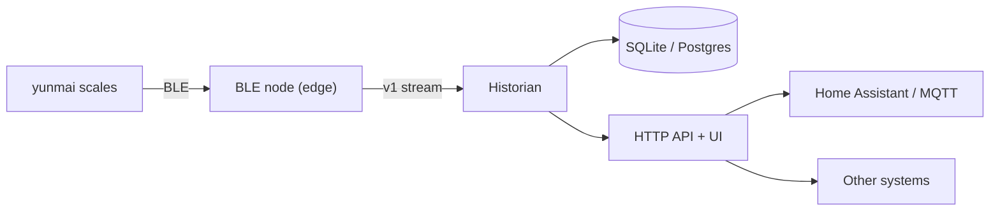

# Deployment plan

## Goal

Ship the same three-boundary system (BLE, persistence, HTTP/HTML/API) on four
targets with one contract and one data model. The BLE placement changes; the
historian and HTTP surface stay the same.



Node and historian may run on the same host or on different networks.

## Component placement

| Target | BLE node | Historian | Client | Storage | Integration |
| --- | --- | --- | --- | --- | --- |
| Raspberry Pi | Pi (D-Bus) | Pi | Browser UI | SQLite | Home Assistant via REST/MQTT |
| Docker cloud | Local agent (Pi / laptop) | Cloud container | Browser / API clients | Postgres or SQLite volume | Public API over TLS |
| NixOS edge | Edge device (D-Bus) | Edge device | LAN browser | SQLite | LAN UI/API |
| Ubuntu laptop | Laptop (D-Bus) | Same `.deb` service | Rust/GPUI app | SQLite | Desktop app, optional HA |

## Raspberry Pi (smart home / Home Assistant)

**Recommended shape:** one host running the node and historian, SQLite on disk,
HTTP on the LAN, Home Assistant as a consumer.

- BLE: `dbus` default against host BlueZ; `noble` legacy only if D-Bus is
  unavailable.
- Packaging options:
  - **Home Assistant OS add-on:** container with `host_dbus: true` and a
    persistent `/data` volume. Validate host D-Bus access on HAOS; fall back to
    `noble` with `NET_ADMIN`/`NET_RAW` if needed.
  - **Raspberry Pi OS:** systemd units or Docker Compose; `run.sh dbus` works
    for the container path.
- Home Assistant integration:
  - Phase 1: REST sensor polling `/api/measurements/latest` and
    `/api/measurements`.
  - Phase 2: historian MQTT publisher with HA discovery for event-driven
    measurements.
  - ESPHome Bluetooth Proxy cannot decode the Yunmai protocol without a custom
    component; do not rely on it.
- UI: served from the historian at `http://<pi>:3000`.

## Docker service (cloud) with a local agent

Run the historian and UI in the cloud; keep a small agent on the local network
for BLE. This avoids exposing the home network.

- **Preferred agent:** the existing node on a Pi, NUC, or old laptop. It
  connects **outbound** to the cloud and pushes v1 messages over WSS, so no
  inbound ports or VPN are required.
- **Cloud:** historian container behind a TLS reverse proxy; SQLite volume for
  one instance, Postgres for HA/multi-instance; API protected by a token.
- **Ingest:** add a historian-side WSS ingest endpoint with per-device tokens;
  the current historian design is a WebSocket client and must gain this mode.
- **Alternative:** a WireGuard/Tailscale link, with the historian connecting to
  the node's LAN WebSocket. Simpler security, more network setup.
- **ESP32 option:** feasible as a low-power BLE-to-Wi-Fi agent, but it is not a
  drop-in node. It needs a BLE-central implementation, Yunmai packet parsing,
  TLS/MQTT, provisioning, and OTA updates. Start with a Pi/laptop agent; treat
  ESP32 as a later prototype that publishes the same v1 MQTT payloads.
- HA integration remains via MQTT or the cloud API.

## NixOS edge device

Package the stack natively and expose it on the local network.

- Flake outputs: `packages.yunmai-node`, `packages.yunmai-historian`,
  `nixosModules.yunmai-noble`, `overlay.default`.
- Module options: `enable`, `driver` (`dbus`), `nodeId`, `dataDir`, `port`,
  `historian.enable`, `corsOrigin`, `openFirewall`, `upstreamUrl`.
- Host setup:
  - `hardware.bluetooth.enable = true;`
  - `hardware.bluetooth.powerOnBoot = true;`
  - a D-Bus policy entry for the service user to talk to `org.bluez`;
  - `services.dbus.enable` (usually implied by systemd/BlueZ).
- Runtime: the node can use Node 22 or a Bun-built bundle; the historian should
  use Bun. Pin the chosen runtime in the flake.
- Storage: `/var/lib/yunmai-historian/historian.sqlite` with a systemd
  `StateDirectory`; backup through the normal NixOS backup mechanism.
- Exposure: historian on the LAN only; firewall opens `3000/tcp` when
  requested. No privileged container or host networking.
- Deployment is declarative via `nixos-rebuild switch`; configuration lives in
  `configuration.nix`.

## Ubuntu `.deb` (service + desktop app)

Four packages are built with `dpkg-deb` from one staged runtime:

| Package | Purpose | Port | Data |
| --- | --- | --- | --- |
| `yunmai-noble-full` | Metapackage: service + desktop client | — | — |
| `yunmai-noble` | Real scale service and web UI | `3000` | `/var/lib/yunmai-noble` |
| `yunmai-noble-desktop` | GPUI dashboard and simulator control app | — | — |
| `yunmai-noble-simulator` | Virtual scale for demos | `3100` | `/var/lib/yunmai-noble-simulator` |

The split keeps X11/Wayland/GL dependencies off headless hosts. The
desktop package talks to the suite API over HTTP and can target a remote
historian; the metapackage is the normal one-command install.
`yunmai-noble-simulator` depends on the exact main version and shares
`/usr/lib/yunmai-noble`; it only adds a unit, a config file, a launcher, and
a desktop entry. See [packaging/deb/README.md](../packaging/deb/README.md).

### `yunmai-noble`

- **Runtime:** Bun bundled at `/usr/lib/yunmai-noble/runtime/bun` (no distro
  Bun dependency), with the workspace sources, production `node_modules`, and
  `packages/ui/dist`. The legacy `noble` addon is excluded with
  `--omit=optional`.
- **Wrapper:** `/usr/bin/yunmai-noble` executes the bundled Bun on
  `packages/suite/src/main.ts`, so supervised drivers reuse the same runtime.
- **Service:** `yunmai-noble.service` runs as the `yunmai` user, joins the
  `bluetooth` group when BlueZ exists, and binds only the state directory via
  `ProtectSystem=strict` + `ReadWritePaths`.
- **Config:** `/etc/yunmai-noble/config.toml` and `config.env` are conffiles;
  the database lives in `/var/lib/yunmai-noble/historian.sqlite`. The service
  starts the drivers in `[drivers] initial`; the desktop client can switch them
  at runtime through `/api/suite`.
- **Dependencies:** `dbus`, `ca-certificates`, `adduser`, and a `libc6`
  minimum detected from the binary. `bluez` is recommended rather than
  required.
- **No GUI dependencies:** the GPUI binaries and their X11/xkb/GL
  libraries live in `yunmai-noble-desktop`.

### `yunmai-noble-desktop`

- `/usr/bin/yunmai-noble-desktop`, `/usr/bin/yunmai-noble-simulator-ui`, the
  "Yunmai Noble" entry, and the icon. It only recommends `yunmai-noble`, so
  a laptop can use it against a remote service.
- The titlebar Settings dialog selects simulator, D-Bus, or node bindings
  and stops the others. When the simulator is active it launches
  `yunmai-noble-simulator-ui`, which drives `/api/suite/simulator` and never
  touches D-Bus.

### `yunmai-noble-full`

- Metapackage with `Depends: yunmai-noble, yunmai-noble-desktop` at the
  exact version. It suggests `yunmai-noble-simulator` rather than
  installing it, since that package starts a second service.

### `yunmai-noble-simulator` (optional)

- The main service can switch to the simulator driver from the app, so this
  package is only for a parallel demo instance with its own database.
- Its unit sets `SUITE_SCALES=simulator` and `SUITE_NODE_ID_PREFIX=sim`, reads
  `/etc/yunmai-noble/simulator.toml`, and listens on `127.0.0.1:3100`.
- The "Yunmai Noble Simulator" desktop entry runs the packaged
  `yunmai-noble-simulator` launcher, which points the client at port `3100`
  and sets `YUNMAI_SERVICE=yunmai-noble-simulator.service`.

### Launcher

The GPUI client probes `/health` before opening. If the historian is
unreachable and the URL is loopback, it starts the packaged system unit and
waits up to ~6 s. `YUNMAI_SERVICE` selects the unit (default
`yunmai-noble.service`); `--no-autostart` or `YUNMAI_AUTOSTART=none` disables
this. The packaged `.desktop` entries rely on the same path. After connecting,
the Settings dialog applies the remembered choice from
`~/.config/yunmai-noble/desktop.json` and stops the other drivers. When the
simulator is active, **Open simulator** launches the separate GPUI control app
against the same historian URL.

### Build and install

```sh
bun install
packaging/deb/build.sh          # or: bun run deb

# desktop + service from the local files
sudo apt install ./dist/deb/yunmai-noble_0.2.2_amd64.deb \
                 ./dist/deb/yunmai-noble-desktop_0.2.2_amd64.deb \
                 ./dist/deb/yunmai-noble-full_0.2.2_all.deb

# headless host
sudo apt install ./dist/deb/yunmai-noble_0.2.2_amd64.deb

# optional parallel demo instance
sudo apt install ./dist/deb/yunmai-noble-simulator_0.2.2_amd64.deb
```

Users installing from the published repository do not build anything; see
[INSTALL.md](../INSTALL.md) for the keyring, `.sources` file, upgrade, and
removal steps.

The post-install script creates the user and data directories, enables and
starts the units, and reloads systemd. `apt remove` keeps the databases;
`apt purge` deletes the data directory and the `yunmai` user.

### Constraints

- The desktop binary links the build host's glibc; the build script derives the
  `libc6` dependency from it. Build on the oldest release you support (the
  current amd64 build requires glibc 2.43).
- Packages are architecture-specific. Build `arm64` on an `arm64` host, or
  cross-compile the Rust client and supply an arm64 Bun binary.
- Without `bluez` the historian and web UI still run, but the `dbus` driver has
  no adapter to talk to.
- The default package omits the native `noble` addon. Node bindings need Node
  22, `@abandonware/noble`, and HCI capabilities for the service user, so the
  suite omits the driver and the client disables it. Direct API starts fail
  fast with an actionable message.

## Shared operations

- **Configuration:** `BLE_DRIVER`, `DBUS_SYSTEM_BUS_ADDRESS`, `NODE_ID`,
  `DATABASE_PATH`/`DATABASE_URL`, `HISTORIAN_HOST/PORT`, `CORS_ORIGIN`, and
  the upstream URL/token for split deployments.
- **Storage:** SQLite WAL for edge/single-host; Postgres for cloud
  multi-instance. Back up by snapshotting the volume or using the SQLite
  backup API.
- **Security:** TLS for anything off-host; per-device tokens for cloud ingest;
  no privileged containers in D-Bus mode; host D-Bus or HCI policy documented
  per target.
- **Health and updates:** `/health` exposes database and upstream state;
  package managers own upgrades; DB migrations run at startup; the v1 contract
  remains backward compatible.
- **Live clients:** the historian should expose an SSE (or WebSocket) relay so
  browser and desktop clients share one live source. SSE is the default for
  the GPUI app.
- **Home Assistant:** REST first, MQTT discovery second. Keep the JSON API
  authoritative so other systems do not depend on HA-specific shapes.

## Milestones

1. Historian, HTTP/SSE surface, browser UI, single-executable suite, GPUI
   client, and the Ubuntu `.deb` pair are done.
2. Harden node configuration, v1 emission, and reconnect behavior.
3. Raspberry Pi single-host deployment plus HA REST integration.
4. NixOS flake and module.
5. Cloud historian with authenticated WSS ingest and outbound agent.
6. MQTT/HA discovery; ESP32 agent prototype.

## Open questions

- SQLite in the cloud for a single instance, or Postgres from the start?
- MQTT discovery or REST sensors as the first Home Assistant integration?
- Is the HAOS add-on allowed host D-Bus, or must it fall back to HCI?
- Is GPUI mature enough on Ubuntu/Wayland, or should the desktop client use
  Tauri/egui?
- Should the desktop app use SSE or WebSocket for live updates?
- Where does TLS terminate for the cloud target: reverse proxy or historian?
- Is an ESP32 agent worth the firmware effort versus a Pi/old laptop?
