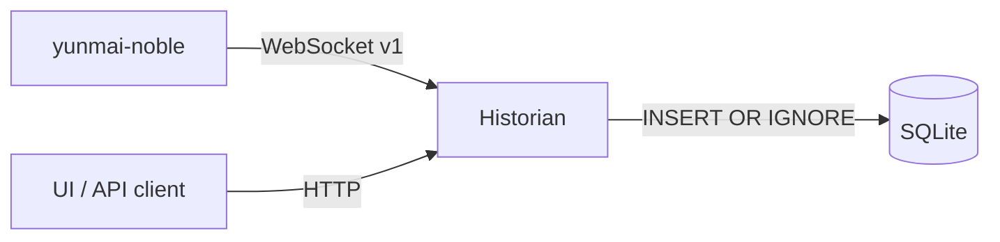

# Weight historian design

## Goal

Collect v1 `measurement.completed` messages from one or more nodes, persist
them, and serve history to UI clients. The historian is a background Bun
service that owns the persistence and HTTP/HTML/API boundaries from
[ARCHITECTURE.md](ARCHITECTURE.md).

Not in scope: BLE access, UI assets, accounts, or authentication.

## Flow



The node still emits v0; adapt frames using the mapping in
[WEBSOCKET.md](WEBSOCKET.md) until the v1 emitter lands.

## Data model

`scale_date` is epoch seconds derived from `payload.measuredAt`.

```sql
PRAGMA journal_mode = WAL;

CREATE TABLE devices (
  id TEXT PRIMARY KEY,
  last_seen_at TEXT NOT NULL,
  firmware_version INTEGER
);

CREATE TABLE measurements (
  id INTEGER PRIMARY KEY AUTOINCREMENT,
  device_id TEXT NOT NULL REFERENCES devices (id),
  scale_date INTEGER NOT NULL,
  user_id INTEGER NOT NULL,
  weight_x100 INTEGER NOT NULL,
  resistance INTEGER NOT NULL DEFAULT 0,
  fat_percentage INTEGER NOT NULL DEFAULT 0,
  historical INTEGER NOT NULL DEFAULT 0,
  firmware_version INTEGER,
  received_at TEXT NOT NULL,
  UNIQUE (device_id, scale_date, user_id, weight_x100)
);

CREATE INDEX idx_measurements_device_date
  ON measurements (device_id, scale_date DESC);
CREATE INDEX idx_measurements_user_date
  ON measurements (user_id, scale_date DESC);
```

- Weight is stored as integer hundredths to avoid float drift.
- `scale_date` is canonical for ordering; `received_at` records ingestion time.
- The unique key excludes `historical`, so live and replayed measurements
  collapse into one row.
- Use `bun:sqlite` behind a `MeasurementStore` interface so a remote database
  can replace it later.

## Ingestion

1. Connect to `YUNMAI_WS_URL` with `ws`.
2. Parse JSON and validate with `ServerMessageSchema`.
3. Keep only `measurement.completed`; use `deviceId` from the envelope.
4. Insert with `INSERT OR IGNORE`; log ignored duplicates and malformed frames.
5. Reconnect with exponential backoff (1–30 s) and ping/pong liveness.
6. Expose connection state through `/health`.

The node does not buffer broadcasts. If the historian is down, live
measurements are lost until the scale replays them as historical packets.

## REST API

| Method | Path | Purpose |
| --- | --- | --- |
| `GET` | `/health` | Process, database, and upstream status |
| `GET` | `/api/measurements` | History query |
| `GET` | `/api/measurements/latest` | Latest measurement |
| `GET` | `/api/devices` | Known devices |

`GET /api/measurements` accepts `from`, `to`, `userId`, `limit` (1–500,
default 100), and `before` (ISO 8601 cursor). Results are ordered by
`scale_date DESC, id DESC`.

```json
{
  "measurements": [
    {
      "id": 42,
      "deviceId": "pi-scale-1",
      "scaleDate": "2026-11-01T13:35:26.000Z",
      "receivedAt": "2026-11-01T13:35:27.120Z",
      "userId": 1,
      "weightKg": 7.41,
      "resistance": 0,
      "fatPercentage": 0,
      "historical": false,
      "firmwareVersion": 1
    }
  ],
  "next": "2026-10-31T08:00:00.000Z"
}
```

Errors use `{ "error": { "code": "...", "message": "..." } }`.

## Configuration

| Variable | Purpose | Default |
| --- | --- | --- |
| `HISTORIAN_HOST` / `HISTORIAN_PORT` | HTTP bind address | `0.0.0.0:3000` |
| `DATABASE_PATH` | SQLite file | `/data/historian.sqlite` |
| `YUNMAI_WS_URL` | Node WebSocket URL | required |
| `YUNMAI_DEVICE_ID` | Device id fallback for v0 frames | `yunmai-noble` |
| `RECONNECT_MIN_MS` / `RECONNECT_MAX_MS` | Backoff bounds | `1000` / `30000` |
| `CORS_ORIGIN` | Allowed client origin | `*` in development |
| `HISTORIAN_API_TOKEN` | Optional write token | unset |

## Deployment

Run the historian as a Bun service next to the node. When containerized, mount
a persistent volume and the D-Bus socket if it needs live node access:

```
docker run -d --name historian \
  --network host \
  -e YUNMAI_WS_URL=ws://127.0.0.1:8080 \
  -e YUNMAI_DEVICE_ID=pi-scale-1 \
  -e DATABASE_PATH=/data/historian.sqlite \
  -v historian-data:/data \
  yunmai-historian
```

## Security and testing

- Bind the unauthenticated API to a trusted network; use a firewall or VPN.
- Use parameterized SQL and restrict CORS in production.
- Store tests: insert, duplicate collapse, filters, cursor paging.
- Ingestion tests: fake `ws` server, malformed frames, reconnect.
- HTTP tests: ephemeral port plus `fetch`.
- End-to-end: node simulator + historian + fake client.
