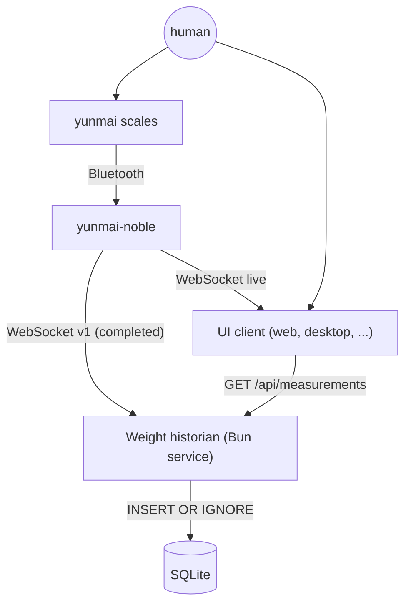
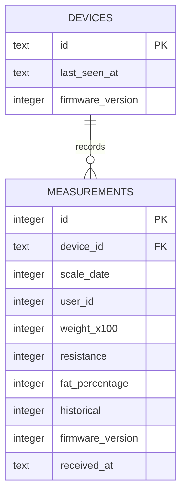

# Weight historian design

## Goal

Collect measurements from one or more `yunmai-noble` nodes, persist them, and
expose query APIs for UI clients (web, desktop, or other). The historian is a
background Bun service and owns the persistence and HTTP/HTML/API boundaries
from [ARCHITECTURE.md](ARCHITECTURE.md).

## Non-goals

- Real-time streaming to clients. UI clients continue to read live data from
  the node's WebSocket.
- Serving UI assets. Clients are separate deployables.
- User accounts, scale-user identity mapping, or goals.
- Multi-tenant access control.
- Replacing the BLE node's WebSocket broadcaster.

## Context

The historian targets the v1 WebSocket contract in
[WEBSOCKET.md](WEBSOCKET.md). The node still emits the unversioned v0 format
until that migration lands; adapt v0 frames using the mapping table in the
contract specification.

A v1 completed measurement looks like:

```json
{
  "v": 1,
  "type": "measurement.completed",
  "deviceId": "pi-scale-1",
  "sentAt": "2026-11-01T13:35:27.120Z",
  "payload": {
    "measuredAt": "2026-11-01T13:35:27.000Z",
    "userId": 1,
    "weight": 750,
    "resistance": 0,
    "fatPercentage": 0,
    "historical": false,
    "firmwareVersion": 1
  }
}
```

`weight` is hundredths of a kilogram. Only `measurement.completed` is
persisted; `measurement.measuring` is transient progress.

## Architecture



The historian is a TypeScript service that runs on Bun with three
responsibilities (Node 22 is only required for the BLE link):

1. **Ingest** — a WebSocket client that connects to the node, validates
   messages, and writes completed measurements.
2. **Store** — a `MeasurementStore` interface backed by SQLite.
3. **Serve** — a small HTTP API for history and health.

UI clients talk to the historian for history and to the node for live data,
matching the idea diagram.

## Data model



`scale_date` is derived from the v1 `payload.measuredAt` timestamp
(`Date.parse(measuredAt) / 1000`).

```sql
PRAGMA journal_mode = WAL;

CREATE TABLE devices (
  id TEXT PRIMARY KEY,
  last_seen_at TEXT NOT NULL,
  firmware_version INTEGER
);

CREATE TABLE measurements (
  id INTEGER PRIMARY KEY AUTOINCREMENT,
  device_id TEXT NOT NULL REFERENCES devices (id),
  scale_date INTEGER NOT NULL,           -- epoch seconds from the scale
  user_id INTEGER NOT NULL,
  weight_x100 INTEGER NOT NULL,          -- 7.41 kg -> 741
  resistance INTEGER NOT NULL DEFAULT 0,
  fat_percentage INTEGER NOT NULL DEFAULT 0,
  historical INTEGER NOT NULL DEFAULT 0, -- payload.historical
  firmware_version INTEGER,
  received_at TEXT NOT NULL,             -- ISO 8601, server clock
  UNIQUE (device_id, scale_date, user_id, weight_x100)
);

CREATE INDEX idx_measurements_device_date
  ON measurements (device_id, scale_date DESC);
CREATE INDEX idx_measurements_user_date
  ON measurements (user_id, scale_date DESC);
```

Design choices:

- **Integers for weight.** Avoid floating-point drift; the API converts to
  kilograms.
- **Both clocks.** `scale_date` is canonical for ordering and display.
  `received_at` records ingestion time and diagnoses clock skew.
- **Idempotent writes.** `historicalInfo` packets replay measurements that may
  also have arrived live. The unique key excludes `historical`, so overlapping
  replays collapse into one row. Duplicate inserts keep the first row.
- **Device column.** The current WS message has no device identity, so the
  historian tags messages with its configured `YUNMAI_DEVICE_ID`. Multi-node
  support means multiple source configurations or an explicit device
  registration protocol later.

### Storage engine

Use Bun's built-in `bun:sqlite` for the MVP: no extra dependency, a single file,
and synchronous access suitable for one node's data volume. All SQL is hidden
behind a `MeasurementStore` interface. If the historian runs on Node, add an
adapter using `node:sqlite` or `better-sqlite3`; Postgres remains an option.

## Ingestion

### Flow

1. Connect to `YUNMAI_WS_URL` with `ws`.
2. Parse each message as JSON and validate it with `ServerMessageSchema`.
3. Keep only `type === "measurement.completed"`.
4. Require `deviceId`, `payload.measuredAt`, and `payload.weight`; the schema
   enforces ranges for `userId`, `resistance`, `fatPercentage`, and
   `firmwareVersion`. Convert `measuredAt` to epoch seconds for `scale_date`.
5. Upsert the device row and insert the measurement with
   `INSERT OR IGNORE`.
6. Log malformed messages and continue; never crash on a bad frame.

### Reconnection

- Reconnect on `close` or `error` with exponential backoff from 1 s to 30 s,
  with jitter; reset the delay after a successful open.
- Send a WebSocket ping every 30 s and terminate the connection when a pong is
  not received, so the client notices a dead network.
- Track `{ connected, lastMessageAt, lastError }` for `/health`.

### Data loss

The node does not queue broadcasts. If the historian is down, live measurements
are lost until the scale replays them as historical packets. Running the
historian next to the node reduces the window. A node-side spool is out of scope
for the first version.

## REST API

Base path `/api`.

| Method | Path | Purpose |
| --- | --- | --- |
| `GET` | `/health` | Process, database, and upstream status |
| `GET` | `/api/measurements` | Query history |
| `GET` | `/api/measurements/latest` | Latest measurement |
| `GET` | `/api/devices` | Known devices |

### `GET /api/measurements`

Query parameters:

| Name | Meaning | Default |
| --- | --- | --- |
| `from` | ISO 8601 lower bound on `scale_date` | none |
| `to` | ISO 8601 upper bound on `scale_date` | none |
| `userId` | Filter by scale user slot | none |
| `limit` | Page size, `1..500` | `100` |
| `before` | Cursor: ISO 8601 `scale_date`; returns older rows | none |

Response:

```json
{
  "measurements": [
    {
      "id": 42,
      "deviceId": "pi-scale-1",
      "scaleDate": "2026-11-01T13:35:26.000Z",
      "receivedAt": "2026-11-01T13:35:27.120Z",
      "userId": 1,
      "weightKg": 7.41,
      "resistance": 0,
      "fatPercentage": 0,
      "historical": false,
      "firmwareVersion": 1
    }
  ],
  "next": "2026-10-31T08:00:00.000Z"
}
```

Rows are ordered by `scale_date DESC, id DESC`. `next` is the `before` cursor
for the next page, or `null` when the page is not full. Cursor pagination keeps
queries cheap as the table grows.

### `GET /api/measurements/latest`

Same object shape, with optional `userId`. Returns `404` when there are no
measurements.

### `GET /health`

```json
{
  "status": "ok",
  "database": { "ok": true },
  "upstream": { "connected": true, "lastMessageAt": "2026-11-01T13:35:27.120Z" }
}
```

Returns `503` when the database or upstream connection is unhealthy.

### Errors

```json
{ "error": { "code": "invalid_query", "message": "limit must be between 1 and 500" } }
```

## Configuration

| Variable | Purpose | Default |
| --- | --- | --- |
| `HISTORIAN_HOST` | HTTP bind address | `0.0.0.0` |
| `HISTORIAN_PORT` | HTTP port | `3000` |
| `DATABASE_PATH` | SQLite file | `/data/historian.sqlite` |
| `YUNMAI_WS_URL` | Node WebSocket URL | required |
| `YUNMAI_DEVICE_ID` | Fallback device id for v0 frames | `yunmai-noble` |
| `RECONNECT_MIN_MS` | Initial backoff | `1000` |
| `RECONNECT_MAX_MS` | Maximum backoff | `30000` |
| `CORS_ORIGIN` | `Access-Control-Allow-Origin` | `*` in development |
| `HISTORIAN_API_TOKEN` | Optional write/ingest token | unset |

## Repository placement

Add the historian as a workspace package:

```
packages/historian/bin/historian.ts          entry point
packages/historian/src/config.ts
packages/historian/src/ingest.ts            WebSocket client and validation
packages/historian/src/store.ts             MeasurementStore + SQLite adapter
packages/historian/src/server.ts            HTTP routing and JSON responses
packages/historian/src/app.ts               composition root
packages/historian/test/*.test.ts
```

It needs `ws` and `bun:sqlite`, plus the existing `@yunmai-noble/contract`
package for message validation. UI clients get their own `packages/ui/`
package.

## Deployment

The historian is a Bun service. Give it a small Docker image when it is ready
and run it next to the node:

```
docker run -d --name historian \
  --network host \
  -e YUNMAI_WS_URL=ws://127.0.0.1:8080 \
  -e YUNMAI_DEVICE_ID=pi-scale-1 \
  -e DATABASE_PATH=/data/historian.sqlite \
  -v historian-data:/data \
  yunmai-historian
```

Host networking lets the historian reach the node at `127.0.0.1:8080` on Linux
and on the Raspberry Pi. On a cloud host, point `YUNMAI_WS_URL` at a reachable
node address and publish port `3000` instead.

## Security

- The read API is unauthenticated in the MVP; bind it to a trusted network and
  keep the Pi behind a firewall or VPN.
- `HISTORIAN_API_TOKEN` is reserved for future ingest or mutation endpoints.
- Every SQL statement uses parameters; no string interpolation of values.
- CORS is restricted to the configured client origins in production.

## Testing

- **Store:** insert, duplicate collapse, date-range and user filters, cursor
  paging.
- **Validation:** malformed weights, dates, user ids, and non-measured packets.
- **Ingestion:** a fake `ws` server emits frames; assert persisted rows and
  reconnect behavior after a dropped connection.
- **HTTP:** start the server on an ephemeral port with an in-memory database and
  use the global `fetch` to exercise every endpoint.
- **End-to-end:** run the node simulator, historian, and a fake UI; assert
  history from the API contains live measurements.

## Implementation order

1. Store interface, SQLite adapter, schema migration, store tests.
2. Message validation and duplicate handling.
3. WebSocket ingestion with reconnect and health state.
4. HTTP API, CORS, error handling, API tests.
5. Deployment service, persistent volume, and docs.
6. End-to-end test with the simulator.

## Decisions to confirm

1. **Live streaming:** UI clients connect to the node directly (recommended,
   as drawn) or the historian relays live data over SSE/WebSocket.
2. **Device identity:** configuration-based id for one node (recommended) or a
   registration protocol for many.
3. **API authentication:** defer reads to the network boundary (recommended) or
   require a token from the start.
4. **Contract migration:** update the node to emit v1 before building ingestion
   (recommended), or ship a v0 adapter in the historian first.
